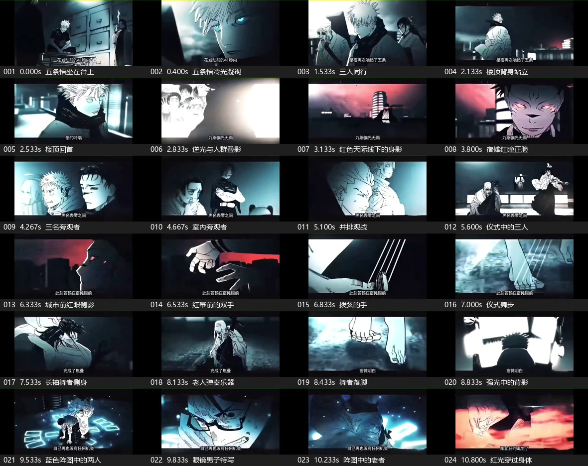

# 小黑子与奶娃 · 动画换角分镜

一段 45.77 秒的动画换角剪辑。宿傩替换为小黑子，五条悟替换为奶娃，保留原镜头的动作方向、构图和光效。这里保存了角色参考、关键帧、提示词、音频及本地剪辑脚本。视频文件只保存在本地。

**看完整片素材** · [65 张替换成品](视频素材/完整素材_场景与人物替换/02_人物替换成品) · [99 个镜头的时间索引](视频素材/完整素材_场景与人物替换/主要场景与人物替换索引.csv) · [模糊人物跳过记录](视频素材/完整素材_场景与人物替换/模糊人物跳过记录.csv)

需要人工接手的 17 个镜头已集中到[待人工处理目录](视频素材/完整素材_场景与人物替换/04_待人工处理)，内附可编辑底图、原截图、前后帧和处理清单。

下载仓库后，用浏览器打开 [逐张对照页](视频素材/完整素材_场景与人物替换/打开查看_原图与替换对照.html)。左边是原始截图，右边是人物替换图或裁去字幕与黑边的净截图。点缩略图可看大图。

| 资料 | 内容 |
| --- | --- |
| [角色与早期测试](视频素材) | 小黑子、奶娃和备用角色参考，早期替换稿、红眼及体型修订记录 |
| [九秒原分镜](视频素材/素材2_主要场景) · [九秒定稿](视频素材/素材2_人物替换) | 13 张场景截图、11 张换角定稿 |
| [逐镜提示词](视频素材/素材2_分镜提示词与即梦测试) · [分段修订](视频素材/素材2_分段提示词_修订版) | 单镜头、分组生成及减少原角色混入的参考方案。修订方案不代表已生成 |
| [九秒剪辑资料](视频素材/素材2_九秒完整成片) | 对比图、切点、历史剪辑脚本和最终剪辑索引 |
| [完整片素材](视频素材/完整素材_场景与人物替换) | 99 张原图，65 张替换成品，34 张免替换净截图 |
| [音频](音频) · [原片九秒音轨](视频素材/素材2_分镜提示词与即梦测试/原片音轨.m4a) | 45 秒本地合成电子配乐，以及九秒片段原声 |
| [剪辑与复现](docs/剪辑说明.md) · [本地视频清单](docs/本地视频清单.csv) | 素材归位、运行顺序、版本差别和视频指纹 |

完整片的 16–25 秒对应九秒测试。该段沿用已有处理结果，另有两张片段外旧图也被复用。65 张成品中有 52 张新图、13 张旧图。15 张因人物模糊整张跳过，另两张只替换能确认的人物。原片截图及原声来自参考视频，仓库未为这些素材授予新的使用许可。
