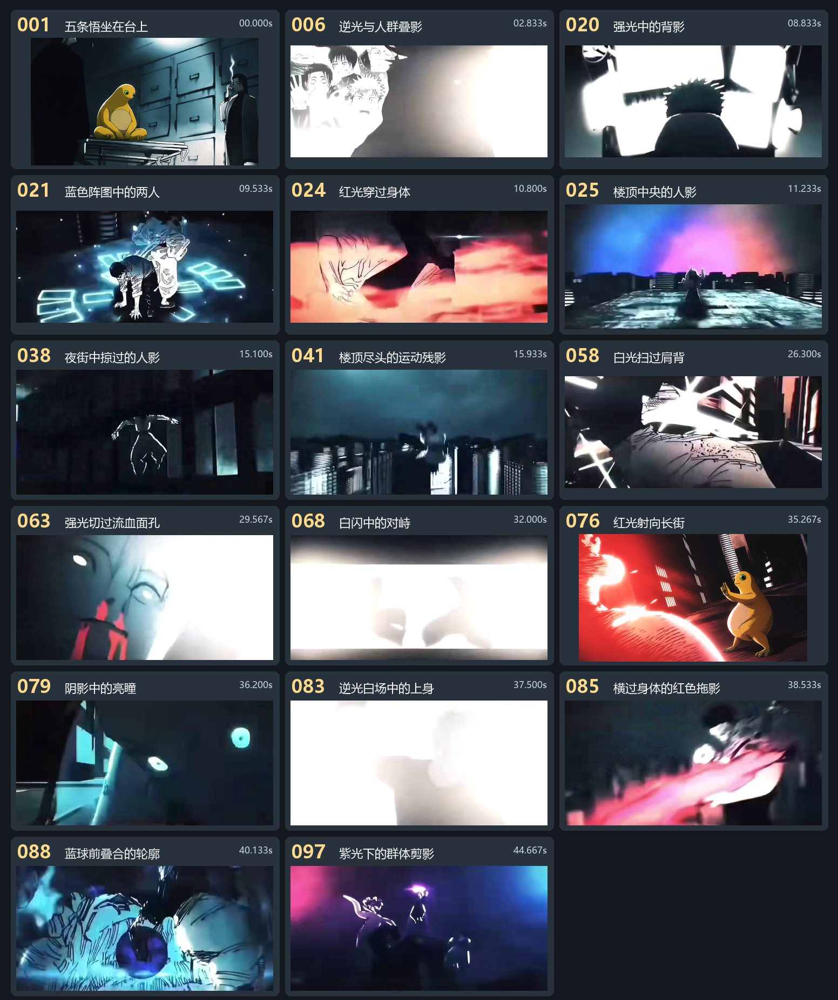

# 待人工处理的 17 个镜头

下载仓库后，在浏览器中打开[逐张标注页面](逐张标注.html)。选择角色并在待处理底图上拖框，每张可标多处。可跳过局部或整张。点击「导出 JSON 清单」保存结果，之后也可导入继续。

打开 [待处理底图](待处理底图) 即可按时间顺序逐张处理。[人工处理清单](人工处理清单.csv) 列出了每张图看不清的位置和原因，可在最后三栏填写进度、身份判断和修改说明。

15 张整镜待判断使用已经裁去字幕和黑边的净截图。另有两张仅需判断局部，底图采用已有替换成品：

- **001 · 0.000 秒**　确认画面最左侧的黑色人影。中央坐在台上的五条悟已换成奶娃，右侧为配角。
- **076 · 35.267 秒**　确认左前景被红光盖住的轮廓。右侧五条悟已换成奶娃。

先看[前后帧参考](前后帧参考)。每条横排中间带星号的是目标帧，两侧依次相隔 4 帧。片头超出视频范围的位置留空。遇到切镜时，请按人物衣饰、站位和动作核对身份。需要查看完整构图时，可打开同编号的[原截图](原截图对照)。

确认是宿傩时换为小黑子，确认是五条悟时换为奶娃，保留原动作、朝向和光效。如果是配角或仍看不清，可在清单注明。保存改图时保留镜头号和秒数，方便后续剪辑回填。
